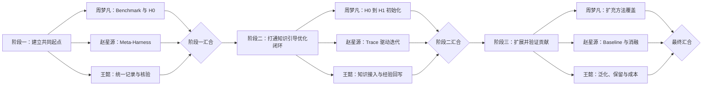

# 三阶段并行执行计划

三个阶段依次推进；同一阶段内，周梦凡、赵星源、王懿并行工作。每个人在本阶段内部按表中顺序串行完成自己的任务。阶段末统一汇合、复核接口和产物，满足进入条件后再开始下一阶段。

## 阶段一：建立共同起点

三人先共同确认模型、预算、数据划分和输出目录，然后并行开展以下工作。

| 负责人 | 串行任务 | 主要产出 | 与其他人的接口 | 完成条件 |
| --- | --- | --- | --- | --- |
| **周梦凡** | ① 配置 Harbor、模型和 Terminal-Bench 2.0；② 跑通单任务 smoke test；③ 运行共同 Terminus-KIRA `H0`；④ 整理失败任务与运行成本 | `H0 + Terminal-Bench 2.0` 的命令、配置、原始 trace、逐题结果、token、费用和时延 | 把统一运行入口、任务 ID、trace 路径和结果表交给赵星源与王懿 | 相同命令可重复运行；训练集结果完整；失败可定位到任务与日志 |
| **赵星源** | ① 跑通 Meta-Harness 官方 KIRA 流程；② 保存每轮候选 harness 和评分；③ 迁移到共同数据划分、模型和预算；④ 标记论文设置与共同协议的差异 | 可重复的 Meta-Harness baseline、候选版本、搜索轨迹和共同协议结果 | 使用周梦凡提供的执行入口；按王懿定义的记录格式输出结果 | Meta-Harness 与共同 `H0` 使用相同评测协议；所有候选与结果可追溯 |
| **王懿** | ① 定义实验目录和运行记录格式；② 统一 trace、分数、成本和配置字段；③ 检查 `H0` 与 Meta-Harness 是否同条件；④ 形成阶段对照表 | 实验记录模板、结果汇总脚本或表格、协议差异清单、阶段核验报告 | 提前把记录接口交给另外两人；汇总两条运行线的产物 | 两组实验字段一致；缺失信息明确；能够一表比较设置、结果和成本 |

**阶段一汇合：**三人共同复跑至少一个相同任务，确认 `H0` 和 Meta-Harness 的输入、模型、预算、trace 与评分口径一致。未满足共同协议时，不进入阶段二。

## 阶段二：打通知识引导优化闭环

阶段开始前先冻结阶段一的运行接口、trace 格式和结果字段。三条开发线并行实现，阶段末再集成为一个闭环。

| 负责人 | 串行任务 | 主要产出 | 与其他人的接口 | 完成条件 |
| --- | --- | --- | --- | --- |
| **周梦凡** | ① 建模任务需求与 `H0` 能力；② 调用已有方法页和代码；③ 生成候选 `H1`；④ 在开发任务上检查触发、行为变化和旧能力 | `H0 → H1` 初始化代码、方法选择理由、代码差异和开发集结果 | 消费王懿提供的方法代码；把 `H1` 和运行 trace 交给赵星源 | 至少生成一个可运行 `H1`；选择理由、修改位置和结果能够对应起来 |
| **赵星源** | ① 从成功与失败 trace 形成诊断；② 提出知识改造或自主探索候选；③ 执行 `Ht → Ht+1`；④ 验证后保留或撤销 | Trace 驱动优化器、候选生成与选择记录、至少一次完整迭代 | 使用周梦凡的 `H1` 和统一 trace；把采用与拒绝结果交给王懿 | 跑通“运行—诊断—修改—验证—保留或撤销”；失败尝试同样被记录 |
| **王懿** | ① 整理首批方法的可运行代码；② 建立方法选择和调用接口；③ 关联外部方法、实际修改与实验结果；④ 回写成功、失败和适用条件 | 可调用的方法目录、知识使用日志、经验回写记录和人工复核清单 | 向周梦凡提供稳定调用接口；接收赵星源的实验反馈并更新适用条件 | 优化流程无需临时检索即可调用方法；外部证据与本地结果保持区分 |

**阶段二汇合：**在同一开发任务上，从共同 `H0` 出发，完整运行初始化和至少一轮 trace 优化。三人共同检查代码版本、知识调用记录、候选 harness、trace、结果和撤销路径是否闭合。

## 阶段三：扩展并验证贡献

阶段二的接口和完整方法作为冻结版本。新增方法、baseline 或评测环境不得改变既有对照口径；确需改变时，所有方法一起重跑。

| 负责人 | 串行任务 | 主要产出 | 与其他人的接口 | 完成条件 |
| --- | --- | --- | --- | --- |
| **周梦凡** | ① 按优先级扩充 harness 模块方法；② 为每个方法补齐直接可用代码；③ 记录依赖、冲突与组合关系；④ 统计采用、改造和拒绝情况 | 多方向方法目录、可运行代码、组合关系和质量复核记录 | 将冻结的方法集合与版本交给赵星源；向王懿提供整理和适配工时 | 各方法都能从索引进入说明并直接调用代码；没有仅有论文摘要而无实现的条目 |
| **赵星源** | ① 运行共同 `H0` 与 Meta-Harness；② 运行完整方法；③ 做初始化、知识、trace 和自主探索消融；④ 重复关键实验 | 同条件 baseline、完整方法与消融结果，逐题配对记录 | 使用周梦凡冻结的方法集合；按王懿的泛化与成本字段输出 | 模型、数据、预算和评测器一致；完整方法与各消融能够回答贡献来源 |
| **王懿** | ① 运行封存测试和第二环境；② 检查新增成功与原有成功退化；③ 汇总计算与人工成本；④ 形成最终结论边界 | 泛化结果、能力保留分析、成本表、失败案例和结论边界 | 接收赵星源的全部运行结果；接收周梦凡的收集、复核和适配工时 | 报告未见任务表现、退化、尝试次数、token、费用、时延和人力投入 |

**最终汇合：**三人共同核对实验矩阵、逐题结果和结论。任何论文主张都必须能追溯到冻结配置、原始运行记录或明确标注的人工判断。

## 统一协作规则

| 项目 | 规则 |
| --- | --- |
| 阶段关系 | 阶段一、二、三严格串行；未通过阶段汇合检查，不提前使用下一阶段结果形成结论。 |
| 阶段内关系 | 三位同学并行开发；每个人自己负责的编号任务按顺序完成。 |
| 分支 | 周梦凡使用 `zhouMF/self-evolution-branch`；赵星源使用 `zhaoXY/self-evolution-branch`；王懿使用 `wangY/self-evolution-branch`。 |
| 公共接口 | 数据划分、模型、预算、trace schema、结果 schema 和目录约定由三人共同确认后进入 `main`。 |
| 合并顺序 | 先合并公共接口，再分别合并三人的阶段产物，最后由非作者复核集成结果。 |
| 结果记录 | 成功、失败、撤销和未运行都要记录；开发集结果不能替代封存测试结论。 |
| 变更控制 | 共同 `H0`、benchmark、模型或预算发生变化时，受影响的 baseline 与方法必须一起重跑。 |
