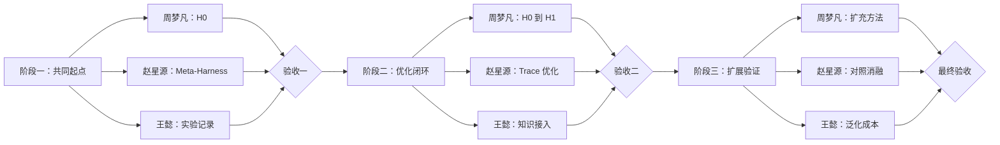

# 三阶段任务计划

阶段之间串行；每个阶段内三人并行。

| 阶段 | 负责人 | 任务 | 产出 |
| --- | --- | --- | --- |
| 一 | **周梦凡** | 配置环境，运行 Terminus-KIRA `H0` | H0 配置、trace、分数与成本 |
| 一 | **赵星源** | 复现 Meta-Harness，并适配共同协议 | Baseline 代码、搜索记录与结果 |
| 一 | **王懿** | 统一实验记录，核对两者评测条件 | 记录模板、对照表与核验结果 |
| 二 | **周梦凡** | 根据任务和方法代码实现 `H0 → H1` | 可运行 `H1`、选择理由与代码差异 |
| 二 | **赵星源** | 实现 `Trace → 诊断 → 修改 → 验证` | 至少一轮 `Ht → Ht+1` 完整记录 |
| 二 | **王懿** | 接入方法代码，记录采用、拒绝与实验反馈 | 方法调用接口与经验回写记录 |
| 三 | **周梦凡** | 扩充不同 harness 模块的方法与代码 | 多方向、可直接运行的方法集合 |
| 三 | **赵星源** | 运行 baseline、完整方法和关键消融 | 同条件对照与消融结果 |
| 三 | **王懿** | 检查未见任务、旧能力和总成本 | 泛化、退化与成本分析 |

| 阶段验收 | 进入下一阶段的条件 |
| --- | --- |
| **验收一** | `H0` 与 Meta-Harness 在相同任务、模型和预算下稳定运行，记录完整。 |
| **验收二** | 从 `H0` 出发，完整跑通初始化和至少一轮 trace 优化，可保留或撤销修改。 |
| **最终验收** | 完成同条件 baseline、消融、封存测试、能力保留与成本分析。 |

分支：周梦凡 `zhouMF/self-evolution-branch`；赵星源 `zhaoXY/self-evolution-branch`；王懿 `wangY/self-evolution-branch`。
