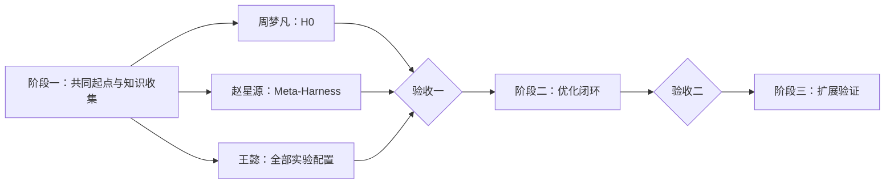

# 三阶段任务计划

阶段之间串行；每个阶段内三人并行。

## 阶段一：共同起点与知识收集

### 实验任务

| 负责人 | 任务 | 仓库相对路径 |
| --- | --- | --- |
| **周梦凡** | 使用统一配置运行 Terminus-KIRA `H0`。 | 代码：`harness/h0/terminus-kira/`；入口：`agents.baseline_kira:AgentHarness`；配置：`experiments/configs/h0.yaml` |
| **赵星源** | 使用统一配置复现 Meta-Harness，共同起点仍为 Terminus-KIRA。 | 代码：`optimizer/baselines/meta-harness/`；配置：`experiments/configs/meta-harness.yaml` |
| **王懿** | 创建并维护全部实验配置，核对两条实验线。 | `experiments/configs/terminal-bench-2.0-common.yaml`、`h0.yaml`、`meta-harness.yaml`、`experiments/README.md` |

### 论文收集任务

| 负责人 | 收集方向 | 数量 |
| --- | --- | --- |
| **周梦凡** | 指令与 Skill；上下文管理与压缩；长期记忆与经验复用；规划与任务进度管理；模型选择与资源分配 | **每个方向 3 篇** |
| **赵星源** | 工具与环境交互；容错与故障恢复；执行循环与调度；会话与环境状态管理；权限审批与运行隔离 | **每个方向 3 篇** |
| **王懿** | 子 Agent 与多 Agent 协作；扩展机制与生命周期钩子；运行观测、Trace 与集成接口；验证、评估与反馈 | **每个方向 3 篇** |

### H0 与 Meta-Harness 的统一配置

全部配置由**王懿**维护。`h0.yaml` 与 `meta-harness.yaml` 只写各自入口和优化器差异，其余参数引用 `terminal-bench-2.0-common.yaml`。周梦凡和赵星源不单独修改公共参数。

| 配置项 | 统一要求 |
| --- | --- |
| 配置文件 | 公共参数：`experiments/configs/terminal-bench-2.0-common.yaml`；H0 入口：`experiments/configs/h0.yaml`；Meta-Harness 入口：`experiments/configs/meta-harness.yaml`。 |
| Benchmark | `benchmarks/terminal-bench-2.0/`，使用同一 `split-v1.json` 和任务 ID。 |
| 初始 Harness | 均从 `harness/h0/terminus-kira/` 开始，不直接修改 H0。 |
| 执行模型 | 模型、provider、temperature、最大上下文和最大输出一致。 |
| 执行预算 | 每题最大 step、tool call、token、墙钟时间和重试次数一致。 |
| 运行设置 | 每题重复次数、并发数、Docker 环境和超时设置一致。 |
| 记录字段 | task ID、配置、trace、分数、token、费用、时延、异常和候选 harness 版本一致。 |
| Meta-Harness 额外成本 | 优化模型、搜索轮数、候选数和优化成本单独记录，不混入执行预算。 |
| 配置变更 | 王懿统一修改；影响公平性的参数变化后，H0 与 Meta-Harness 一起重跑。 |

### 论文如何入库

1. 每篇论文建立 `knowledge/sources/<paper-id>/`，保存 PDF、GitHub 链接和来源说明。
2. 将论文与 GitHub 链接、负责人和进度同步到 `docs/research-plan.md` 的 2.1 表格。
3. 比较同一方向的 3 篇论文，至少选择 1 个高价值方法写入 `knowledge/methods/<method>/README.md`。
4. 把可直接使用的代码放入 `knowledge/methods/<method>/code/`，并在 `knowledge/README.md` 登记。

现有 [`query-specific-skill-refinement`](../knowledge/methods/query-specific-skill-refinement/README.md) 计入“指令与 Skill”的第 1 篇，可继续重构；周梦凡还需补充 2 篇。

## 阶段二与阶段三

| 阶段 | 负责人 | 任务 |
| --- | --- | --- |
| 二 | **周梦凡** | 根据任务和方法代码实现 `H0 → H1`。 |
| 二 | **赵星源** | 实现 `Trace → 诊断 → 修改 → 验证`。 |
| 二 | **王懿** | 接入方法代码，记录采用、拒绝与实验反馈。 |
| 三 | **周梦凡** | 扩充不同 harness 模块的方法与代码。 |
| 三 | **赵星源** | 运行 baseline、完整方法和关键消融。 |
| 三 | **王懿** | 检查未见任务、旧能力和总成本。 |

| 阶段验收 | 条件 |
| --- | --- |
| **验收一** | H0 与 Meta-Harness 在统一配置下稳定运行；2.1 每个方向登记 3 篇论文，并至少形成 1 个带可用代码的方法。 |
| **验收二** | 从 H0 出发，跑通初始化和至少一轮 trace 优化。 |
| **最终验收** | 完成同条件 baseline、消融、封存测试、能力保留与成本分析。 |
