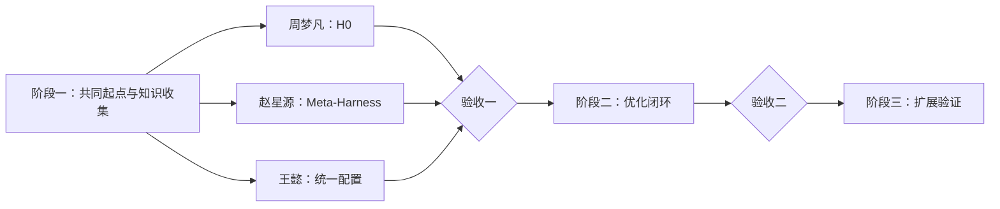

# 三阶段任务计划

阶段之间串行；每个阶段内三人并行。

## 阶段一：共同起点与知识收集

| 负责人 | Baseline 任务与仓库相对路径 | 分配的论文收集方向 |
| --- | --- | --- |
| **周梦凡** | 运行 Terminus-KIRA `H0`。代码：`harness/h0/terminus-kira/`；入口：`agents.baseline_kira:AgentHarness`；配置：`experiments/configs/h0.yaml`。 | 指令与 Skill、上下文管理与压缩、长期记忆与经验复用、规划与任务进度管理、模型选择与资源分配 |
| **赵星源** | 复现 Meta-Harness。代码放入：`optimizer/baselines/meta-harness/`；实验配置：`experiments/configs/meta-harness.yaml`；共同起点仍使用 `harness/h0/terminus-kira/`。 | 工具与环境交互、容错与故障恢复、执行循环与调度、会话与环境状态管理、权限审批与运行隔离 |
| **王懿** | 建立共同实验配置：`experiments/configs/terminal-bench-2.0-common.yaml`；核对 H0 与 Meta-Harness；更新 `experiments/README.md`。 | 子 Agent 与多 Agent 协作、扩展机制与生命周期钩子、运行观测 Trace 与集成接口、验证评估与反馈 |

### H0 与 Meta-Harness 的统一配置

| 配置项 | 统一要求 |
| --- | --- |
| Benchmark | `benchmarks/terminal-bench-2.0/`，使用同一 `split-v1.json` 和任务 ID。 |
| 初始 Harness | 均从 `harness/h0/terminus-kira/` 开始，不直接修改 H0。 |
| 执行模型 | 模型、provider、temperature、最大上下文和最大输出一致。 |
| 执行预算 | 每题最大 step、tool call、token、墙钟时间和重试次数一致。 |
| 运行设置 | 每题重复次数、并发数、Docker 环境和超时设置一致。 |
| 记录字段 | task ID、配置、trace、分数、token、费用、时延、异常和候选 harness 版本一致。 |
| Meta-Harness 额外成本 | 优化模型、搜索轮数、候选数和优化成本单独记录，不混入执行预算。 |

### 论文收集与知识库

每个方向先收集一篇高价值论文或工程方法，并按以下路径整理：

| 内容 | 仓库相对路径 |
| --- | --- |
| 论文、GitHub 与来源记录 | `knowledge/sources/<paper-id>/` |
| 方法说明 | `knowledge/methods/<method>/README.md` |
| 可直接使用的实现 | `knowledge/methods/<method>/code/` |
| 总索引 | `knowledge/README.md` |
| 各方向论文与 GitHub 链接 | `docs/research-plan.md` 的 2.1 表格 |

现有 [`query-specific-skill-refinement`](../knowledge/methods/query-specific-skill-refinement/README.md) 作为首个参考，可按实际使用问题继续重构。

## 阶段二与阶段三

| 阶段 | 负责人 | 任务 |
| --- | --- | --- |
| 二 | **周梦凡** | 根据任务和方法代码实现 `H0 → H1`。 |
| 二 | **赵星源** | 实现 `Trace → 诊断 → 修改 → 验证`。 |
| 二 | **王懿** | 接入方法代码，记录采用、拒绝与实验反馈。 |
| 三 | **周梦凡** | 扩充不同 harness 模块的方法与代码。 |
| 三 | **赵星源** | 运行 baseline、完整方法和关键消融。 |
| 三 | **王懿** | 检查未见任务、旧能力和总成本。 |

| 阶段验收 | 条件 |
| --- | --- |
| **验收一** | H0 与 Meta-Harness 在统一配置下稳定运行；2.1 各方向至少登记一项材料，并形成对应方法目录。 |
| **验收二** | 从 H0 出发，跑通初始化和至少一轮 trace 优化。 |
| **最终验收** | 完成同条件 baseline、消融、封存测试、能力保留与成本分析。 |
