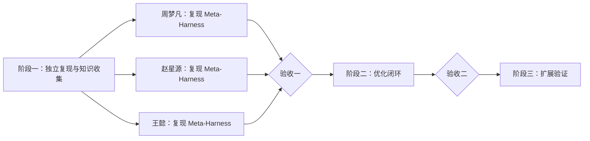

# 三阶段任务计划

阶段之间串行；每个阶段内三人并行。

## 阶段一：独立复现 Meta-Harness 与知识收集

### 实验任务

| 负责人 | 任务 | 仓库相对路径 |
| --- | --- | --- |
| **周梦凡** | 使用统一架构与配置跑通共同 H0 和 Meta-Harness，并独立保存完整结果。 | 代码：`harness/h0/terminus-kira/`、`optimizer/baselines/meta-harness/`；配置：`experiments/configs/meta-harness.yaml`；结果：`experiments/results/meta-harness/zhouMF/` |
| **赵星源** | 使用统一架构与配置跑通共同 H0 和 Meta-Harness，并独立保存完整结果。 | 代码：`harness/h0/terminus-kira/`、`optimizer/baselines/meta-harness/`；配置：`experiments/configs/meta-harness.yaml`；结果：`experiments/results/meta-harness/zhaoXY/` |
| **王懿** | 使用统一架构与配置跑通共同 H0 和 Meta-Harness，并独立保存完整结果。 | 代码：`harness/h0/terminus-kira/`、`optimizer/baselines/meta-harness/`；配置：`experiments/configs/meta-harness.yaml`；结果：`experiments/results/meta-harness/wangY/` |

### 论文收集任务

| 负责人 | 收集方向 | 数量 |
| --- | --- | --- |
| **周梦凡** | 指令与 Skill；上下文管理与压缩；长期记忆与经验复用；规划与任务进度管理；模型选择与资源分配 | **每个方向 2 篇** |
| **赵星源** | 工具与环境交互；容错与故障恢复；执行循环与调度；会话与环境状态管理；权限审批与运行隔离 | **每个方向 2 篇** |
| **王懿** | 子 Agent 与多 Agent 协作；扩展机制与生命周期钩子；运行观测、Trace 与集成接口；验证、评估与反馈 | **每个方向 2 篇** |

### 论文如何入库

1. 每篇论文建立 `knowledge/sources/<paper-id>/`，保存 PDF、GitHub 链接和来源说明。
2. 将论文与 GitHub 链接、负责人和进度同步到 `docs/research-plan.md` 的 2.1 表格。
3. 把各个方向的高价值方法写入 `knowledge/methods/<method>/README.md`。
4. 把可直接使用的代码放入 `knowledge/methods/<method>/code/`，并在 `knowledge/README.md` 登记。

现有 [`query-specific-skill-refinement`](../knowledge/methods/query-specific-skill-refinement/README.md) 计入“指令与 Skill”的第 1 篇，可继续重构。

### 统一复现架构与配置（以下仅供参考）

三人共同使用同一份 Meta-Harness 代码和配置，不建立个人配置。运行结果按成员分别保存，以便核对环境差异和运行稳定性。

| 配置项 | 统一要求 |
| --- | --- |
| 配置文件 | 三人共同维护 `experiments/configs/terminal-bench-2.0-common.yaml`、`h0.yaml` 和 `meta-harness.yaml`。 |
| Benchmark | `benchmarks/terminal-bench-2.0/`，使用同一 `split-v1.json` 和任务 ID。 |
| 初始 Harness | 均从 `harness/h0/terminus-kira/` 开始，不直接修改 H0。 |
| 执行模型 | 三人统一使用 `deepseek-v4-flash`；provider、temperature、最大上下文和最大输出保持一致。 |
| 优化模型 | Meta-Harness 的优化 Agent 统一使用 `deepseek-v4-flash`。 |
| 执行预算 | 每题最大 step、tool call、token、墙钟时间和重试次数一致。 |
| 运行设置 | 每题重复次数、并发数、Docker 环境和超时设置一致。 |
| 记录字段 | task ID、配置、trace、分数、token、费用、时延、异常和候选 harness 版本一致。 |
| Meta-Harness 额外成本 | 优化模型、搜索轮数、候选数和优化成本单独记录，不混入执行预算。 |
| 配置变更 | 公共参数须由三人商量后修改；影响公平性的参数变化后三份复现一起重跑。 |

以下只是配置字段示例，具体字段、取值和默认值由三人讨论后写入公共配置。

| 配置部分 | 可讨论的字段示例 |
| --- | --- |
| Benchmark | 数据路径、split、任务范围、是否先跑 smoke task |
| H0 | harness 路径、Python 入口、prompt 路径、可编辑边界 |
| 执行模型 | `deepseek-v4-flash`、provider、API 地址、temperature、上下文长度、最大输出 |
| 执行预算 | 最大 step、tool call、token、单题超时、重试次数 |
| 运行方式 | 重复次数、并发数、Docker 设置、缓存是否启用 |
| 记录方式 | trace 保存路径、逐题分数、token、费用、时延、异常、候选版本 |
| Meta-Harness | 优化模型固定为 `deepseek-v4-flash`；共同确定搜索轮数、每轮候选数、候选选择规则和优化预算 |
| 凭据 | 只配置环境变量名，不把 API key 或密码写入仓库 |

公共参数的讨论结果记录到 `experiments/configs/README.md`；未达成一致的字段先标记为“待定”，不要各自采用不同值。三人完成后交叉核对配置、trace、分数与成本记录。

## 阶段二与阶段三

| 阶段 | 任务 |
| --- | --- |
| 二 | 根据任务和方法代码实现 `H0 → H1`。 |
| 二 | 实现 `Trace → 诊断 → 修改 → 验证`。 |
| 二 | 接入方法代码，记录采用、拒绝与实验反馈。 |
| 三 | 扩充不同 harness 模块的方法与代码。 |
| 三 | 运行 baseline、完整方法和关键消融。 |
| 三 | 检查未见任务、旧能力和总成本。 |

| 阶段验收 | 条件 |
| --- | --- |
| **验收一** | 三人分别完成 Meta-Harness 独立复现，结果可追溯且满足统一协议；2.1 每个方向登记 2 篇论文，并整理其中的高价值方法与可用代码。 |
| **验收二** | 从 H0 出发，跑通初始化和至少一轮 trace 优化。 |
| **最终验收** | 完成同条件 baseline、消融、封存测试、能力保留与成本分析。 |
