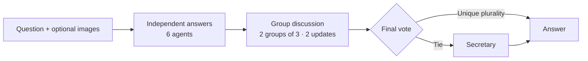

<h1 align="center">
  Rethinking the Bounds of LLM Reasoning:<br>
  Are Multi-Agent Discussions the Key?
</h1>

<p align="center"><strong>Conquer-and-Merge Discussion (CMD) · ACL 2024</strong></p>

<p align="center">
  Qineng Wang<sup>1*</sup>, Zihao Wang<sup>2*</sup>, Ying Su<sup>2</sup>,
  Hanghang Tong<sup>3</sup>, Yangqiu Song<sup>2</sup>
</p>
<p align="center">
  <sup>1</sup>Zhejiang University &nbsp; <sup>2</sup>HKUST &nbsp; <sup>3</sup>UIUC<br>
  <sup>*</sup>Equal contribution
</p>

<p align="center">
  <a href="https://aclanthology.org/2024.acl-long.331/"></a>
  <a href="https://aclanthology.org/2024.acl-long.331.pdf"></a>
  <a href="#results"></a>
  <a href="pyproject.toml"></a>
</p>

## 📢 Updates

- **[2026-09-28]** Updated implementation with async OpenRouter inference and [MindCube-Tiny / AIME results](#results).
- **[2024-08]** Paper published at ACL 2024.

## 🌟 Overview

This is the official repository for **Rethinking the Bounds of LLM Reasoning: Are Multi-Agent Discussions the Key?** It implements CMD for math and visual reasoning, supporting single agents, same-model discussions, and discussions across different models.

CMD divides agents into groups. Agents exchange answers and explanations within their group and see answer counts from other groups. A final vote selects the answer; a secretary resolves ties.



## ⚙️ Setup

Requires **Python 3.10+**; no local GPU is needed.

```bash
git clone https://github.com/HKUST-KnowComp/LLM-discussion.git
cd LLM-discussion
python -m venv .venv
source .venv/bin/activate
python -m pip install -e '.[benchmarks]'
```

## 🚀 Quick Start

Run a complete discussion offline with the included GSM8K data:

```bash
llm-discussion run --dry-run --scenario tie \
  --dataset data/gsm8k-test.jsonl --limit 2 --output runs/quickstart
llm-discussion evaluate runs/quickstart
```

Dry runs need no API key and use synthetic responses, so they do not report benchmark accuracy.

For live evaluation, set `OPENROUTER_API_KEY` in your environment or a local `.env` file using [.env.example](.env.example). `.env` is ignored by Git.

```bash
llm-discussion prepare mindcube
llm-discussion suite --config examples/vision-suite.json \
  --dataset data/benchmarks/mindcube/tasks.jsonl --limit 3 --sample-seed 42 \
  --task-concurrency 12 --request-concurrency 24 --output runs/mindcube-live
llm-discussion evaluate runs/mindcube-live
```

The suite runs three single-agent baselines, three homogeneous CMD conditions, and one mixed CMD condition through OpenRouter. Configure models in [vision-suite.json](examples/vision-suite.json) or [math-suite.json](examples/math-suite.json):

| Model | API reasoning |
| --- | --- |
| `openai/gpt-6-luna` | Disabled |
| `google/gemma-4-31b-it` | Disabled |
| `meta/muse-spark-1.3-contributor` | Minimal |

See the [running guide](docs/running.md) for full evaluations and custom settings, or the [data format](data/README.md) to use your own questions.

<a id="results"></a>

## 📊 Results

September 2026 evaluation on **MindCube-Tiny (1,050 questions), AIME 2025 (30), and AIME 2026 (30)** using the models above. Each arrow shows **single agent → homogeneous CMD** accuracy (%).

| Model / condition | MindCube-Tiny | AIME 2025 | AIME 2026 |
| --- | ---: | ---: | ---: |
| GPT-6 Luna | 46.76 → 48.67 | 16.67 → 33.33 | 36.67 → 40.00 |
| Gemma 4 | 57.05 → 60.29 | 56.67 → 63.33 | 53.33 → 66.67 |
| Muse Spark | 71.33 → 75.81 | 86.67 → 90.00 | 90.00 → 93.33 |
| Mixed CMD | 70.38 | 70.00 | 76.67 |

CMD uses six agents in two groups for three rounds. Mixed groups contain one agent per model, with Luna as secretary. Scores cover the full question sets; unsuccessful runs count as incorrect. These are results with current models and datasets.

## 🛠️ Development

```bash
python -m pip install -e '.[dev,benchmarks]'
python -m pytest -q
llm-discussion --help
```

Implementation: `src/llm_discussion/`. Configurations: `examples/`. Tests use synthetic agents and mocked APIs.

## 📖 Citation

If you use CMD, please cite:

```bibtex
@inproceedings{wang-etal-2024-rethinking-bounds,
  title = "Rethinking the Bounds of {LLM} Reasoning: Are Multi-Agent Discussions the Key?",
  author = "Wang, Qineng and Wang, Zihao and Su, Ying and Tong, Hanghang and Song, Yangqiu",
  booktitle = "Proceedings of the 62nd Annual Meeting of the Association for Computational Linguistics (Volume 1: Long Papers)",
  year = "2024",
  publisher = "Association for Computational Linguistics",
  pages = "6106--6131",
  doi = "10.18653/v1/2024.acl-long.331",
  url = "https://aclanthology.org/2024.acl-long.331/"
}
```
